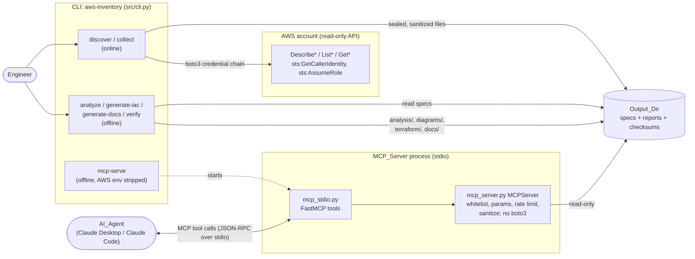
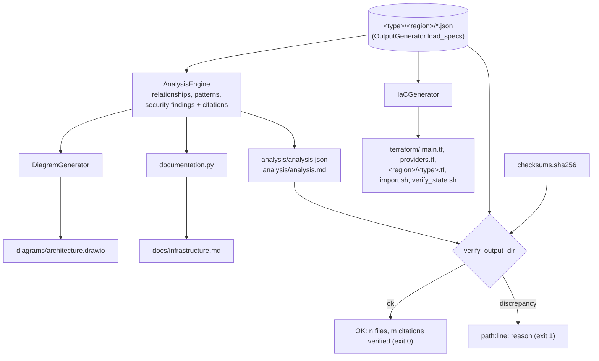

# Architecture

This document describes how `aws-inventory` is built: which components exist, how data moves from AWS into the Output_Dir, and how an AI agent reaches that data through the MCP server. The binding contracts (schemas, file layout, tool parameters) are in [.kiro/specs/aws-resource-inventory/design.md](../.kiro/specs/aws-resource-inventory/design.md); this page is the overview.

## Design principles

1. **Online/offline split.** Only `discover` and `collect` call AWS. Every other command, and the MCP server, reads the Output_Dir only. Results are reproducible and can be audited without account access.
2. **One source of truth per concept.** Resource type names, ids and file paths come from `src/resource_types.py`; checksums and citations from `src/integrity.py`; redaction from `src/sanitizer.py`.
3. **Verifiable statements.** Every relationship, pattern and finding carries a citation that `aws-inventory verify` resolves against the sealed spec files.
4. **Defense in depth for secrets.** Data is sanitized before it is written, every MCP response is sanitized again, and every log record passes through a sanitizing filter.

## Components and interaction



The AI agent is outside the system boundary. It launches `aws-inventory mcp-serve --cache-dir <Output_Dir>` as a child process (configured in its MCP settings) and calls four tools: `list-resources`, `get-resource-spec`, `analyze-activity-flow` and `generate-documentation`. The server process has no AWS credentials and its code does not import boto3, so the agent cannot reach the account through it. It also cannot get answers about resources outside the collected data: unknown ARNs return an error telling the user to run `collect`.

## Data flow: AWS to Output_Dir

```mermaid
sequenceDiagram
    autonumber
    participant CLI as aws-inventory collect
    participant S as aws_session
    participant D as ResourceDiscovery
    participant C as InventoryCollector / SpecCollector
    participant AWS
    participant I as integrity.seal_specs
    participant O as OutputGenerator
    participant FS as Output_Dir

    CLI->>S: create_session(profile, role_arn, external_id)
    S->>AWS: sts:AssumeRole (only with --role-arn)
    S->>AWS: sts:GetCallerIdentity
    CLI->>D: discover_all_resources() [phase: discovery]
    par one worker per region
        D->>AWS: DescribeInstances, ListFunctions, ListTables, ... (paginated)
    end
    D-->>CLI: DiscoveredResource list + DiscoveryErrors
    CLI->>C: collect_all(resources) [phase: collection]
    par one SpecCollector per (service, region), max_workers resources at a time
        C->>AWS: primary call (e.g. DescribeTable)
        C->>AWS: secondary calls (tags, attributes, policies)
        Note over C,AWS: up to 3 attempts, 1 s / 2 s backoff or Retry-After;<br/>botocore retries disabled
    end
    C-->>CLI: ResourceSpecs + CollectionErrors + operation log
    CLI->>O: generate_json / markdown / raw / manifest [phase: output]
    O->>I: seal_specs (sanitize, set metadata.checksum)
    O->>FS: #lt;type#gt;/#lt;region#gt;/#lt;id#gt;.json|.md, resources.*, raw_responses/
    CLI->>FS: discovery.json, collection_report.json, summary_report.md
    CLI->>FS: checksums.sha256, checksums.json
```

A failure never stops the run. A failed region or list call becomes a `DiscoveryError`. A primary call that still fails after its retries becomes a `CollectionError`, and that resource is skipped. A denied or missing secondary configuration only omits that key. All of these appear in `collection_report.json`, and any discovery or collection error makes `collect` exit with code 1.

## Offline pipeline



Every command that writes files regenerates `checksums.sha256` at the end, so `verify` always checks the latest state.

## Module map

| Module | Responsibility |
|---|---|
| `src/cli.py` | Click CLI, sanitized logging (`SanitizingFilter`), console output, exit codes |
| `src/aws_session.py` | boto3 session (profile, assume-role), botocore retries disabled, account id |
| `src/discovery.py` | Concurrent per-region listing with pagination |
| `src/inventory.py` | Groups resources by (service, region) and drives one `SpecCollector` per group |
| `src/collector.py` | Per-type spec collection, retry/backoff, error classification, operation log |
| `src/resource_types.py` | Registry of the 33 supported types: ids, aliases, ARN layout, file names, draw.io styles |
| `src/parser.py` | `ResourceSpec`, `Result`, JSON parse/print |
| `src/sanitizer.py` | Structure-preserving redaction |
| `src/integrity.py` | Canonical JSON, Spec_Checksum, sealing, citation resolution, `verify_output_dir` |
| `src/output_generator.py` | All Output_Dir writers, `load_specs` |
| `src/metrics.py` | Phase timer, run metrics, time savings |
| `src/analysis_engine.py` | Relationship/pattern/security rules with citations |
| `src/diagram_generator.py` | draw.io (mxGraph XML) with `mxgraph.aws4.*` stencils |
| `src/iac_generator.py` | Terraform mapping, import and plan-verification scripts |
| `src/documentation.py` | `docs/infrastructure.md` with citation markers |
| `src/mcp_server.py` | MCP core: whitelist, parameter validation, rate limit, sanitization (no boto3) |
| `src/mcp_stdio.py` | FastMCP stdio transport and environment sandbox |
| `src/sample_account.py` | Sample account used by the demo and tests (moto only) |
| `src/moto_compat.py` | ElastiCache replication groups and ECS service network configuration for moto 4.x (demo, tests and benchmark only) |

## Output_Dir layout

```
<Output_Dir>/
├── manifest.json                       account, regions, start/end, tool version, counts
├── resources.json  resources.md        all resources
├── <type>/<region>/<file_id>.json|.md  one sealed spec per resource (the MCP cache)
├── raw_responses/<type>/<region>/<file_id>_raw.json
├── discovery.json                      discovered resources + discovery errors
├── collection_report.json              operations, errors, phases, metrics, time savings
├── summary_report.md                   manual vs automated effort
├── analysis/analysis.json  analysis/analysis.md      (analyze)
├── diagrams/architecture.drawio                      (analyze)
├── docs/infrastructure.md                            (generate-docs)
├── terraform/                                        (generate-iac)
└── checksums.sha256  checksums.json    refreshed by every command that writes
```

`<type>` is the canonical type id (the Terraform type name). S3 buckets, IAM roles, CloudFront distributions, Route 53 zones and CloudFront-scope WAF web ACLs use the region `global`. Only `<type>/<region>/*.json` files whose `<type>` is a registered type are read as specs; other directories are never mistaken for specs. A complete example is in [examples/output/](../examples/output/).

## Concurrency

- Discovery runs one worker per region (`--max-workers`, default 10).
- Collection creates one boto3 client and `SpecCollector` per (service, region) and collects up to `--max-workers` resources at a time.
- The MCP server handles one request at a time over stdio and re-reads the cache on every request, so a new `collect` is visible without restarting it.
